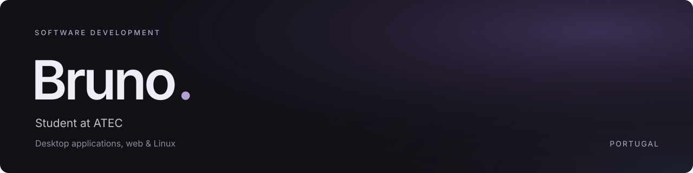

<div align="center">



<br />

**Learning by building. Understanding what happens under the hood.**

[About](#01--about-me) · [Projects](#02--selected-work) · [Toolbox](#03--my-toolbox) · [Learning](#04--learning-path)

</div>

<br />

## 01 / About me

Hey, I'm **Bruno**, a software development student at **ATEC, Portugal**.

I like turning an idea into something I can actually use — from web interfaces to desktop applications. I'm especially interested in **Linux**, **application architecture** and how the pieces of a program fit together.

This profile is where I share what I'm building, experimenting with and learning along the way.

```text
bruno/
├── building     → web projects & desktop applications
├── exploring    → Linux, tooling & software architecture
└── approach     → build it, understand it, make it better
```

## 02 / Selected work

### 👟 [Every Step Count](https://github.com/caeragasv3893-prog/Every-Step-Count)

A website for **ATEC Palmela's #TodosOsPassosContam initiative**: bringing class results, rankings and daily achievements together around a shared solidarity challenge.

`Community project` `Leaderboards` `Social impact`

### 🛍️ [Store Template](https://github.com/caeragasv3893-prog/Store-Template-Open-Source)

A responsive fashion storefront built with **HTML, CSS and JavaScript**, featuring light and dark modes and a front-end shopping cart. A starting point for customisation.

`Open source` `Responsive design` `Front-end only`

### 🐧 [Fedora Dotfiles](https://github.com/caeragasv3893-prog/Fedora-Dotfiles)

A work-in-progress home for my Fedora configuration. Still taking shape as I explore and refine my Linux setup.

`Linux` `Fedora` `Work in progress`

**[Browse all public repositories ↗](https://github.com/caeragasv3893-prog?tab=repositories&type=public)**

## 03 / My toolbox

Technologies I'm learning and working with across my projects.

**Languages**


**Web & interfaces**


**Tools & environment**


## 04 / Learning path

- **Studying:** software development at ATEC.
- **Going deeper:** Python, C/C++, TypeScript and application architecture.
- **Certifications:** Linux Essentials · Intermediate Python.

<br />

---

<div align="center">

<sub>From the first working version to the next better one.</sub>

**Build. Understand. Improve.**

</div>
