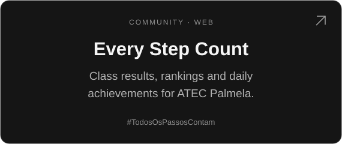
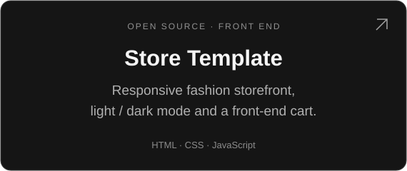
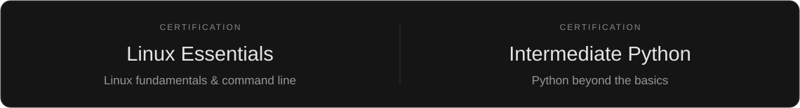

<!-- Monochrome profile. Technology logos adapted from devicons/devicon. -->

<picture>
  <source media="(prefers-color-scheme: light)" srcset="https://raw.githubusercontent.com/caeragasv3893-prog/caeragasv3893-prog/main/assets/profile-mono/hero-light.svg" />
  
</picture>

<b>Software Development Student</b> 
ATEC · Portugal

I build web and desktop projects while learning how software works under the hood. 
My interests include application architecture, Linux and practical development.

 

<h3>Languages &amp; tools</h3>

Technologies I'm learning and working with

 
Python · C · C++ · C# · JavaScript · TypeScript

 
HTML · CSS · React · Node.js · Vite

 
Linux · Fedora · Git · VS Code · Visual Studio · CMake

 

<h3>Selected projects</h3>

&nbsp;

 

<h3>Certifications</h3>

 
 

Currently studying Python, C/C++, TypeScript and application architecture.

