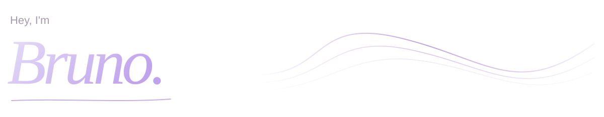

<!-- References: caneco/caneco, anuraghazra/anuraghazra. Technology logos: devicons/devicon. -->

<picture>
  <source media="(prefers-color-scheme: dark)" srcset="https://raw.githubusercontent.com/caeragasv3893-prog/caeragasv3893-prog/main/assets/profile-v4/intro-dark.svg" />
  <source media="(prefers-color-scheme: light)" srcset="https://raw.githubusercontent.com/caeragasv3893-prog/caeragasv3893-prog/main/assets/profile-v4/intro-light.svg" />
  
</picture>

**Software development student at ATEC · Portugal**

I'm into **desktop applications**, **web development** and **Linux**. I like taking an idea far enough to use it, then figuring out how to make it work better.

Most of what you'll find here comes from coursework, personal experiments and things I wanted to try for myself.

 

### Languages & tools

The technologies I'm learning and using across my projects.

  
  &nbsp;
  
  &nbsp;
  
  &nbsp;
  
  &nbsp;
  
  &nbsp;
  

Python · C · C++ · C# · JavaScript · TypeScript

 

  
  &nbsp;
  
  &nbsp;
  
  &nbsp;
  
  &nbsp;
  

HTML · CSS · React · Node.js · Vite

 

  
  &nbsp;
  
  &nbsp;
  
  &nbsp;
  
  &nbsp;
  
  &nbsp;
  

Linux · Fedora · Git · VS Code · Visual Studio · CMake

 
 

### A few things I've made

#### [Every Step Count ↗](https://github.com/caeragasv3893-prog/Every-Step-Count)

A website for **ATEC Palmela's #TodosOsPassosContam** solidarity challenge. Class results, rankings and daily achievements in one place, with a bit of friendly competition along the way.

Community project / Web development

 

#### [Store Template ↗](https://github.com/caeragasv3893-prog/Store-Template-Open-Source)

A fashion storefront template with responsive layouts, light and dark modes, and a front-end shopping cart. Built with **HTML, CSS and JavaScript**, and open for others to customise.

Open source / Front-end only

 

#### [Fedora Dotfiles ↗](https://github.com/caeragasv3893-prog/Fedora-Dotfiles)

A place for my Fedora configuration as I work on my Linux setup. Still a work in progress.

Linux / Configuration

 

[See all public repositories →](https://github.com/caeragasv3893-prog?tab=repositories&type=public)

 

### What I'm learning

I'm working on **Python**, **C/C++**, **TypeScript** and how to structure applications beyond the first working version.

**Certifications** &nbsp; Linux Essentials · Intermediate Python

 

---

ATEC, Portugal &nbsp;·&nbsp; Desktop, web & Linux
