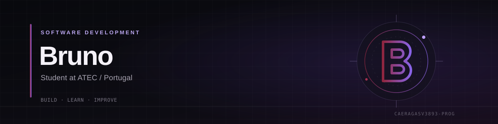

 

---

## About

I'm a software development student at **ATEC in Portugal**, focused on learning how to build reliable applications and developing a strong foundation in programming.

I like working on practical projects, exploring how software works under the hood, and improving my skills by solving real development problems.

- **Currently learning:** Python, C/C++, TypeScript and React Native
- **Main interests:** Application development, desktop software, Linux and software architecture
- **Approach:** Understand the fundamentals, build projects, iterate and improve

## Projects

### [ShieldBrowser](https://github.com/caeragasv3893-prog/shieldbrowser)

A Windows desktop browser project focused on a practical browsing experience and useful built-in features.

- Browser profile management and ongoing feature development
- Update handling and desktop packaging
- Built as a long-term software project

`Desktop development` `Browser` `JavaScript / TypeScript`

### OrbitLauncher

A native Windows launcher for Minecraft, combining a C++ backend with a React and TypeScript frontend.

- Minecraft version and loader management
- Profile management, mods and shaders
- Native Windows integration through WebView2

`C++` `React` `TypeScript` `CMake` `WebView2`

## Certifications

&nbsp;

## Technologies

**Languages**

 

**Frameworks & Runtime**

 

**Tools & Platforms**

## GitHub Activity

&nbsp;

  

---

**Learning continuously. Building things that work.**

