<!-- Custom SVG cards live in assets/profile-v3. No external rendering services. -->

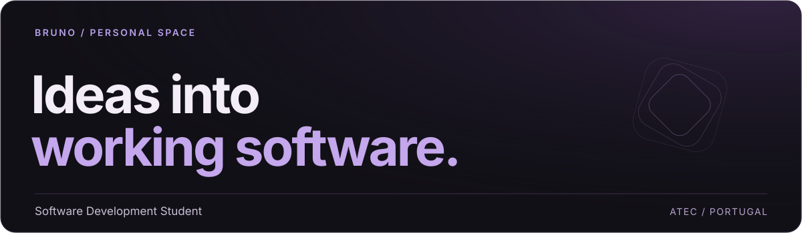

  <a href="#about">About</a> &nbsp;·&nbsp;
  <a href="#projects">Projects</a> &nbsp;·&nbsp;
  <a href="#toolbox">Toolbox</a> &nbsp;·&nbsp;
  <a href="#learning">Learning</a>

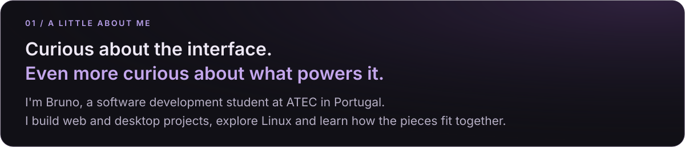

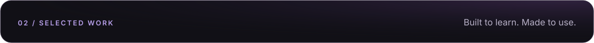

<a href="https://github.com/caeragasv3893-prog/Every-Step-Count">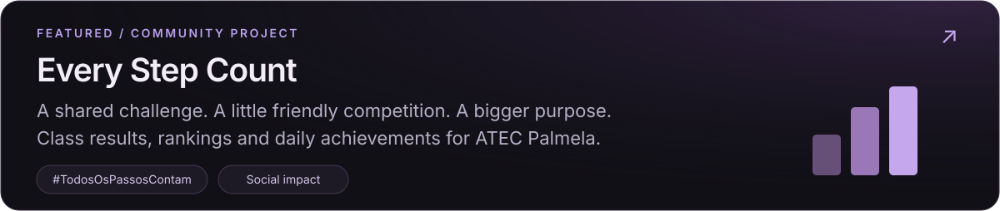</a>

<a href="https://github.com/caeragasv3893-prog/Store-Template-Open-Source">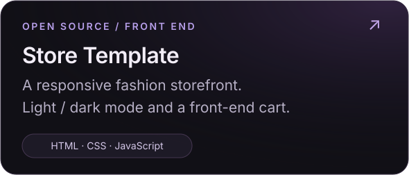</a>
&nbsp;
<a href="https://github.com/caeragasv3893-prog/Fedora-Dotfiles">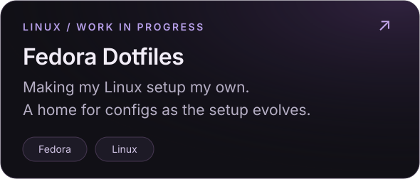</a>

<a href="https://github.com/caeragasv3893-prog?tab=repositories&amp;type=public">All public repositories ↗</a>

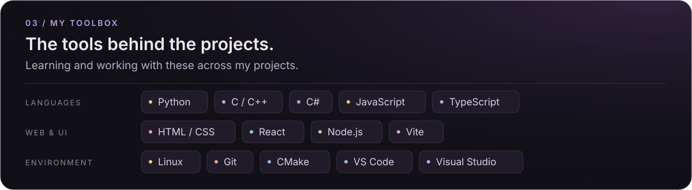

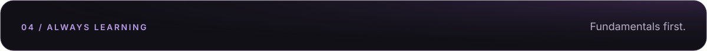

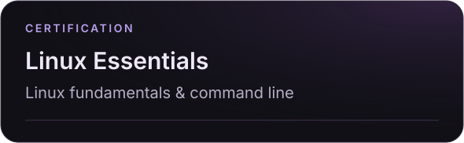
&nbsp;
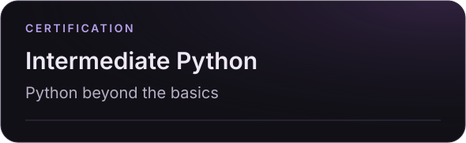

<a href="https://github.com/caeragasv3893-prog?tab=repositories">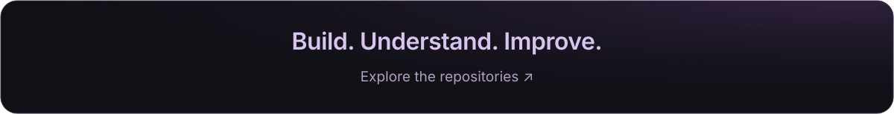</a>

Profile in plain text

I'm **Bruno**, a software development student at **ATEC, Portugal**, interested in desktop applications, web development, Linux and software architecture.

- **[Every Step Count](https://github.com/caeragasv3893-prog/Every-Step-Count):** a community challenge website with class results, rankings and daily achievements.
- **[Store Template](https://github.com/caeragasv3893-prog/Store-Template-Open-Source):** a responsive HTML, CSS and JavaScript storefront with light/dark mode and a front-end cart.
- **[Fedora Dotfiles](https://github.com/caeragasv3893-prog/Fedora-Dotfiles):** my Fedora configuration, currently a work in progress.
- **Learning and working with:** Python, C/C++, C#, JavaScript, TypeScript, HTML/CSS, React, Node.js, Vite, Linux, Git, CMake, VS Code and Visual Studio.
- **Certifications:** Linux Essentials · Intermediate Python.

